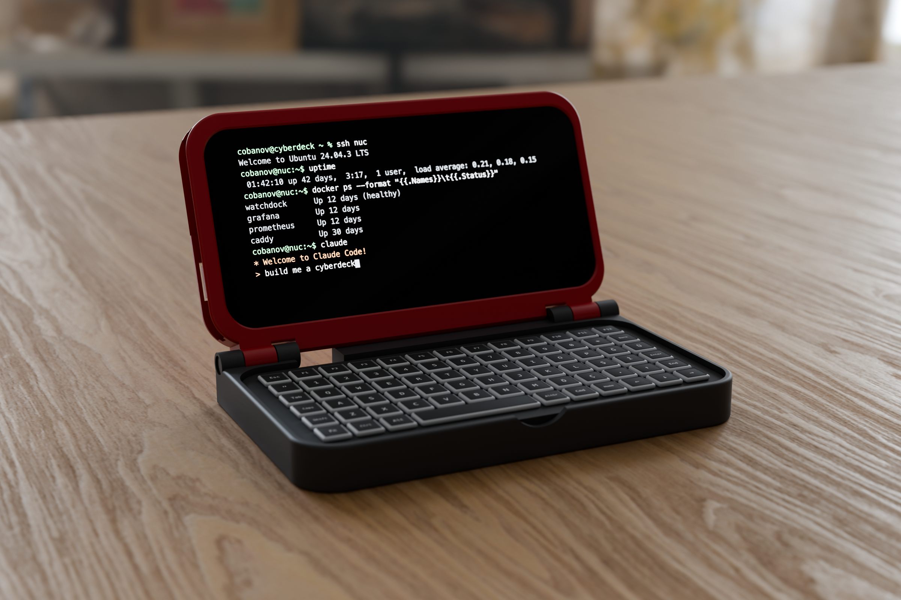
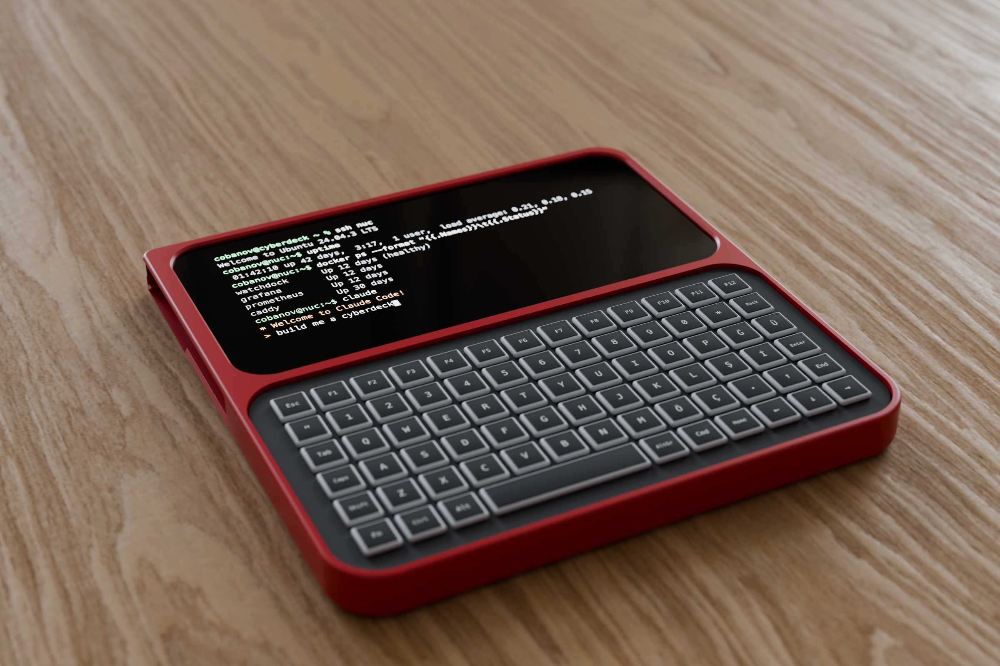

# Cyberdeck

Two pocket cyberdecks from a Torima M7 mini Bluetooth keyboard and an iPhone 12 mini, printed on a Creality K1:

- **Clamshell** (`cyberdeck.py`): keyboard in the base, phone in a lid that locks open at 112°.
- **Slate** (`slate.py`): one 2DS-style piece, phone on top, keyboard below.

Both share the measurements and the slide-in phone bay in `deck.py`. Turn the models in a browser and download them
at [cyberdeck.cobanov.dev](https://cyberdeck.cobanov.dev).





## Highlights

- **Matched footprints.** The keyboard (133 × 68 mm) and the phone (131.5 × 64.2 mm) are almost the same size. The
  clamshell closes to 138 × 81 × 24.5 mm; the slate is 138 × 140 × 13.4 mm.
- **Slide-in phone, one-piece frame.** The phone slides in from the left between the back plate and a lip that runs
  all the way round the screen. The lip covers 1 mm of the phone's 3.3 mm black border, never the screen. A flexing
  tongue in the plate clicks in behind the clamshell's phone; the slate's holds it by its snug fit alone. The camera
  bump slides along a groove into its own window. The side button has a flared window; grooves keep the buttons from
  being pressed as the phone slides in. The slate's bay opens with a 45° lead-in on its rails, plate and camera groove, and a gentler ramp under the frame.
- **Keys at rim height.** In the clamshell the rim stands 0.3 mm above the key tops, so edge keys are easy to press.
  With it closed only the screen glass faces the keys, 1.5 mm above them. In the slate the keyboard's housing sits
  2.7 mm below the screen face and the key tops 1.2 mm below it. A notch at its USB-C port leaves room for the port.
- **Clamshell stops at 112°.** A web across the back of the lid lands flat on the base just behind the hinge pins.
  Open, the lid and phone weigh behind the axis, so gravity keeps the lid on its stop and taps on the screen push
  into it. The base ends at the hinge, with nothing sticking out behind. Pull the lid forward to close it. A slot
  behind the keyboard fits a USB-C plug to charge it in place.
- **Both hold the keyboard without glue.** It presses into a pocket 0.4 mm larger all round and stays by friction;
  a window in the back pushes it out again.
- **Made to print.** Every part prints in one piece. The lid needs supports under its two hinge knuckles. The slate's
  print STL closes the screen window with a 0.2 mm skin under the frame lips, so the lips bridge the 65 mm across the
  bay from wall to wall, and the camera window with a skin on the first layer; cut both out after printing. Its
  supports grow from the bed only, outside the bay's open end and the side windows, so none are trapped inside. The
  keyboard pocket's rim and the windows in the back are chamfered. The frame's
  left end bridges the 65 mm phone slot one layer above the side lips, so the slicer spans it wall to wall. Every
  flexing part bends along its layers, and the phone bay's heights sit on layer lines.
- **Self-checking.** The scripts assert that the lid swings clear up to the stop, the stop engages and the lid's weight holds it open, that the
  keyboard and phone fit, and that the phone is held on every side. The phone must also slide out with only the
  latch, if any, in its way. The latch stays under 1 % strain.

## Parts and print times

Creality K1, the `PLA @K1 cobanov` preset (Elas PLA Pro values), 0.2 mm layers, 3 walls, 20 % gyroid, no brim or skirt
(`slice_k1.sh`, OrcaSlicer estimates). Plates in print order:

| File | What | Print | Time | PLA |
|---|---|---|---|---|
| `stl/fit_keyboard.stl`, `stl/fit_phone.stl` | Clamshell: keyboard pocket slice; left end of the phone bay | One plate, before the base and lid: try the slide and click | 26 min | 10 g |
| `stl/base.stl` | Clamshell: keyboard tray and hinge | Floor down, no supports | 57 min | 32 g |
| `stl/lid.stl` | Clamshell: phone bay, hinge knuckles | Plate down, tree supports under the knuckles | 1 h 22 min | 37 g |
| `stl/slate.stl` | Slate | Back down, tree supports from the bed, screen face ironed; cut the skins out of the screen and camera windows | 2 h 2 min | 55 g |
| `stl/radius_gauge.stl` | Corner radius gauge, 7–11.5 mm | Flat; only for a different keyboard or phone | 31 min | 13 g |
| `stl/radius_gauge_case.stl`, `stl/radius_gauge_lid.stl` | Case for the gauge tiles, sliding lid | Upright and flat, no supports | 32 min | 15 g |

The clamshell is about 2 h 20 min and 69 g; the slate 2 h 2 min and 55 g. No part needs a brim or a skirt (the
K1 draws its own purge line). The frame lips bridge 60–120 mm over the phone slot and sagged slightly on the part
fan alone, so `slice_k1.sh` switches the side fan on for bridges only (it stays off otherwise, since it blows on the
bed).

## Hardware

- Clamshell: 2 × M3×20 socket head screws, the hinge pins. They self-tap into the inner base knuckle, no nuts.
- Optional MagSafe steel ring sticker behind the phone. Without it, set `RING = 0`.

## Assembly

**Phone, both builds.** Screen towards the frame, slide it in from the left Lightning end first until it stops; the
camera ends up on the left. In the clamshell the latch clicks in behind it: to take it out, push the latch bump into
the plate through the open end with a fingernail or a card, and slide the phone out. The slate has no latch; slide
the phone straight out.

**Clamshell.** The hinge is not print-in-place. Close the lid on the base: each lid knuckle drops into the gap between two base
knuckles. From each side, drive an M3×20 through the counterbored outer knuckle and the lid knuckle into the inner
knuckle. The screw is the hinge pin, and tightening it adds friction. The lid's bore is 3.1 mm so the shank sits
snugly; if it binds, run a 3 mm drill through. Drop the keyboard into the tray.

**Slate.** Snap off the supports outside the open end and the side windows. Cut the skin out of the screen window:
run a utility knife along the frame's inner edge, or push its middle down until it breaks away along the edge. Push
the camera window's skin out from the back. Press the keyboard in keys up. To remove it, push it out through the window in the back; take it out to
charge it.

## Customizing

Measurements and fits shared by both builds are in `deck.py`; each script holds its own mechanism (`cyberdeck.py`
the hinge and lock, `slate.py` its slimmer phone bay and flush keyboard). `CORNER_R` is the corner radius shared by the keyboard and the
phone: press a corner into each tile of the radius gauge, and use the one that touches along the whole arc.

Regenerate from FreeCAD's Python console (or its MCP):

```python
exec(open("/Volumes/cobanov-ssd/Workspace/3d-projects/cyberdeck/cyberdeck.py").read(), {})
exec(open("/Volumes/cobanov-ssd/Workspace/3d-projects/cyberdeck/slate.py").read(), {})
```

This rebuilds the `.FCStd` files, the STLs and the render meshes. Then `./slice_k1.sh` writes G-code to
`gcode/k1-pla/`; it refuses a file whose filament settings don't match `profiles/k1_pla_filament.json`.

## Terminal app

The phone runs [DeckTerm](https://github.com/cobanov/deckterm), a landscape SSH terminal made for this deck. It has
its own repo.

## Render

`render/scene.py` builds the scene in Blender 5.2 (Cycles): the deck on an oak desk lit by the `artist_workshop`
HDRI, with a lit terminal on the phone. It renders every shot in its `SHOTS` table unless shots are named.
`--color=white`, `mint` or `black` prints the lid or slate in that colour into `render/colors/` (the default is red;
the clamshell base stays charcoal).

```sh
/Applications/Blender.app/Contents/MacOS/Blender -b -P render/scene.py -- --render [--preview] [--slate] [--color=mint] [shot ...]
```

Assets in `render/assets/` are CC0 from Poly Haven.

## Website

`site/` is [cyberdeck.cobanov.dev](https://cyberdeck.cobanov.dev): static files on Cloudflare and a three.js viewer
that opens and closes the clamshell, in any of the four colours. `site/deploy.sh` publishes it with the STLs from the last commit, so the
downloads never carry a change still being tried.

## Status

The radius gauge and the phone bay test are printed. `CORNER_R` is 10 mm, measured on both the keyboard and the
iPhone 12 mini. The first full lid and base (2026-10-31) printed cleanly and the keyboard fits well. Two changes came
after them and are not printed yet:

- The phone stopped 1-2 mm short of the closed right end, so the latch bump only half caught its edge. The bay's
  right-end corners now have 2 mm less radius and the camera groove 2 mm more length, the two places that could stop
  it. The volume-button window's ends ramp so a fingertip reaches the buttons.
- The 14 mm hinge foot behind the keyboard looked bulky. The base now ends at the hinge pins (91 → 81 mm deep) and
  the open-lock magnets are gone. The lid now lands on a 2.5 mm strip instead of 10.5 mm, so print errors move the
  open angle more: 0.1 mm moves it about 2°. The deck also tips back more easily on a desk.

Nothing holds the lid closed yet; a closing lock is still to design.

The first slate (2026-11-01) printed without supports: its frame lips sagged, the keyboard sat too deep and the
phone latch broke. The key height was remeasured (housing 9.5 mm, keys 1.5 mm proud; the clamshell base is 1 mm
thinner for it too), and the slate was redrawn: no latch, keyboard press-fit and flush, 2 mm walls, 11.6 mm thick
instead of 14.4, and a lead-in at the phone bay's mouth. That version (white, 2026-11-01) had two faults. The tree
supports under the lips couldn't be removed from inside the bay. The keyboard's housing stayed 0.5–1 mm proud and
sprang back out, as its top edge never got inside the pocket. The pocket went 1.2 mm deeper (12 mm thick), and a
one-layer skin replaced the supports. That third slate's lips came out flat, but the frame over the open end still
sagged and the keyboard still sat flush: the clamshell base has a slot at the keyboard's USB-C port, the slate had none.
Now the slate has the notch, the pocket is 1.5 mm deeper again (13.4 mm thick), bed-only tree supports carry the open
end, and the sharp edges at the bay's mouth and round the keyboard are chamfered.
