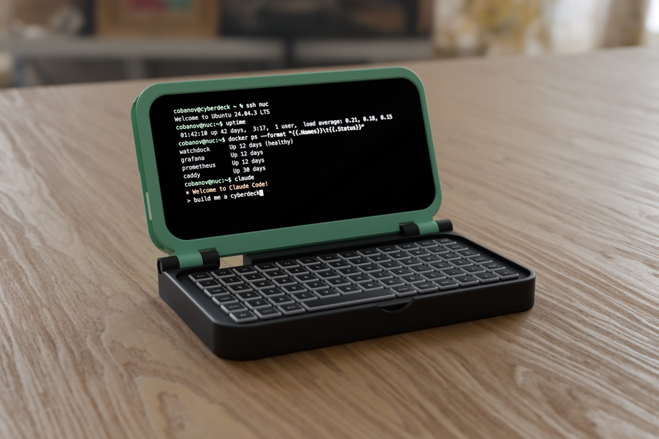
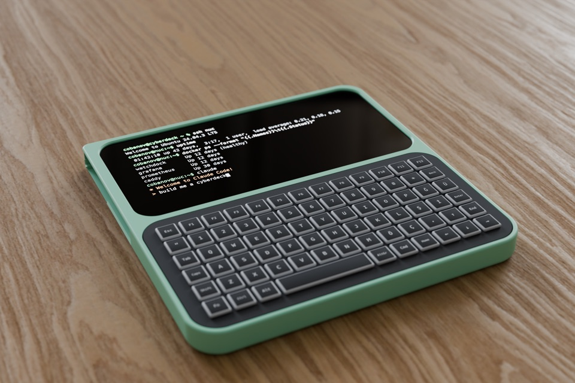

# Cyberdeck

A pocket deck you can print: an iPhone 12 mini and a Torima M7 mini Bluetooth keyboard in a 3D-printed shell, in two
builds.

- **Clamshell.** The keyboard sits in the base, the phone in a lid that stays open at 112°. 138 × 81 × 24.5 mm closed.
- **Slate.** One flat piece, phone above the keyboard. 138 × 141 × 13.4 mm.

In both, the phone drops into an open pocket, and its own MagSafe magnets hold it to a steel ring sticker. There is
nothing over the screen and no latch to break.

Turn the models in your browser and download them at **[cyberdeck.cobanov.dev](https://cyberdeck.cobanov.dev)**.

<p>
  
  
</p>

## What you need

- An iPhone 12 mini
- A Torima M7 mini Bluetooth keyboard (133 × 68 × 9.5 mm)
- A MagSafe steel ring sticker, about 56 mm across
- For the clamshell, 2 × M3×20 socket head screws as hinge pins

## Print

These times and weights are for a Creality K1 in PLA: 0.2 mm layers, 3 walls, 20 % gyroid, no brim or skirt.
`./slice_k1.sh` slices every part with the profiles in `profiles/`.

| File | Part | How | Time | PLA |
|---|---|---|---|---|
| `stl/slate.stl` | Slate | Back down, no supports | 1 h 33 min | 53 g |
| `stl/base.stl` | Clamshell base | Floor down, no supports | 57 min | 32 g |
| `stl/lid.stl` | Clamshell lid | Back down, supports under the two hinge knuckles | 1 h 4 min | 34 g |
| `stl/fit_keyboard.stl` | A slice of the keyboard pocket, to try the fit | Flat | 7 min | 3 g |
| `stl/radius_gauge*.stl` | A corner radius gauge and its case, for another phone or keyboard | Flat | 1 h 3 min | 28 g |

## Assemble

1. Stick the ring sticker into the round recess in the phone pocket.
2. Press the keyboard in, keys up. Friction holds it. To charge it, push it out through the window in the back.
3. Drop the phone in screen out, camera on the left. To take it out, push it up through the window in the back.
4. Clamshell only: close the lid on the base so each lid knuckle sits between two base knuckles. Drive an M3×20 in
   from each side; the screws are the hinge pins, and tightening them adds friction.

## Change it

Every measurement is a named parameter. The shared ones are in `deck.py`: the keyboard, the phone, the fits and the
MagSafe pocket. `cyberdeck.py` and `slate.py` build the two shells and assert that everything fits: both pockets hold
their part, the phone lifts straight out, the lid swings clear and stays open on its own. `radius_gauge.py` builds
the gauge.

```sh
freecadcmd slate.py        # or cyberdeck.py, radius_gauge.py
```

Each script rebuilds its `.FCStd`, STLs and render meshes. In FreeCAD's Python console, use
`p = "<repo>/slate.py"; exec(open(p).read(), {"__file__": p})`. You'll most likely change these:

- `RING_D`, and `MAG_DX` and `MAG_DY`: your ring sticker's diameter, and its offset from the phone's centre.
- `CORNER_R`, the corner radius shared by the phone and keyboard. Print the radius gauge and find the tile whose
  arc touches all along.

## Renders and site

`render/scene.py` renders the decks on an oak desk in Blender 5.2 (Cycles). The HDRI and wood in `render/assets/`
are CC0 from Poly Haven.

```sh
blender -b -P render/scene.py -- --render [--slate] [--color=mint|white|black] [shot ...]
```

`site/` holds [cyberdeck.cobanov.dev](https://cyberdeck.cobanov.dev), a static page with a three.js viewer.
`site/deploy.sh` publishes it with the models from the last commit.

## Status

The first clamshell and four slates printed in October and November 2026; the git log has what each one taught. The
MagSafe lid and slate have not been printed yet. Nothing holds the clamshell's lid closed, and the keyboard has to come
out of the slate to charge.

The phone runs [DeckTerm](https://github.com/cobanov/deckterm), a landscape SSH terminal made for this deck.
