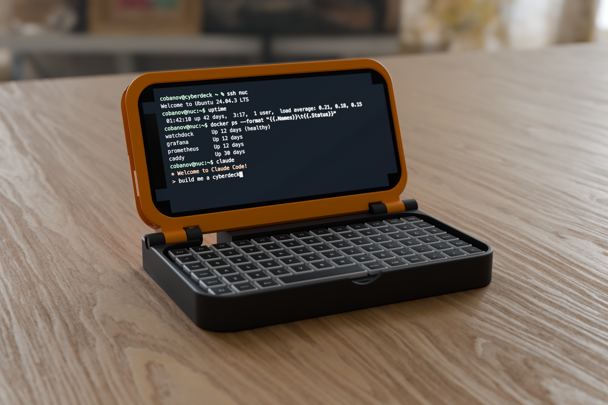
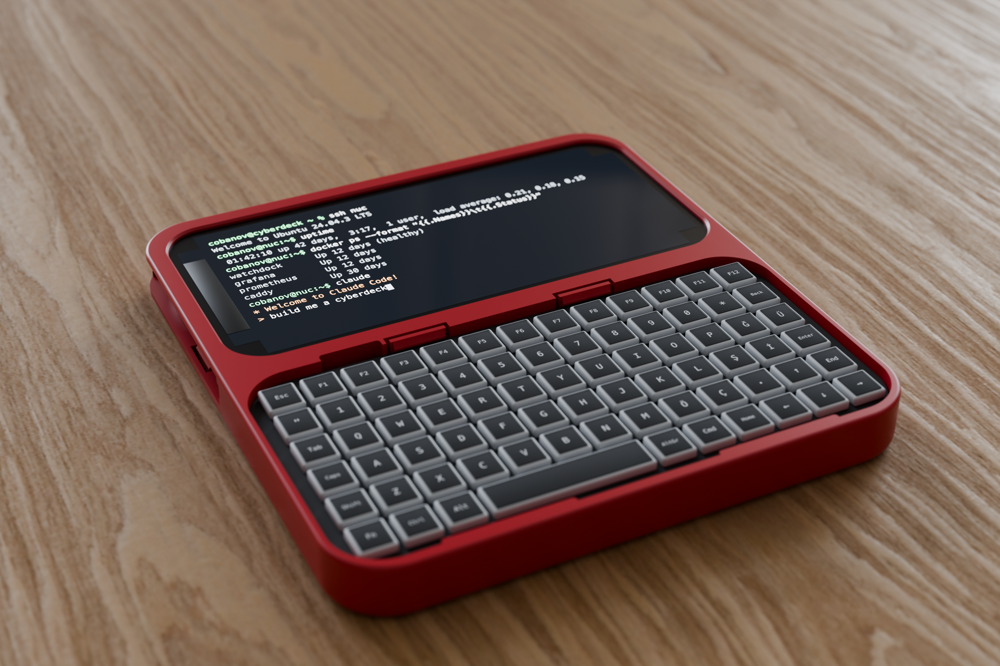

# Cyberdeck

Two pocket cyberdecks from a Torima M7 mini Bluetooth keyboard and an iPhone 12 mini, printed on a Creality K1:

- **Clamshell** (`cyberdeck.py`): keyboard in the base, phone in a lid that locks open at 112°.
- **Slate** (`slate.py`): one 2DS-style piece, phone on top, keyboard below.

Both share the measurements and the slide-in phone bay in `deck.py`.





## Highlights

- **Matched footprints.** The keyboard (133 × 68 mm) and the phone (131.5 × 64.2 mm) are almost the same size. The
  clamshell closes to 138 × 91 × 25.5 mm; the slate is 138 × 147 × 14.4 mm.
- **Slide-in phone, one-piece frame.** The phone slides in from the left between the back plate and a lip that runs
  all the way round the screen. The lip covers 1 mm of the phone's 3.3 mm black border, never the screen. A flexing
  tongue in the plate clicks in behind the phone, and the camera bump slides along a groove into its own window. The
  side button has a flared window; grooves keep the buttons from being pressed as the phone slides in.
- **Keys at rim height.** The rim stands 0.3 mm above the key tops, so edge keys are easy to press. With the
  clamshell closed only the screen glass faces the keys, 1.5 mm above them.
- **Clamshell locks at 112°.** A web across the back of the lid lands flat on the rear foot, and three pairs of
  magnets snap it there: no wobble, and taps on the screen push into the stop. Pull the lid forward to close it.
  A channel through the foot fits a USB-C plug to charge the keyboard in place.
- **Slate holds the keyboard without glue.** It tilts in under two fixed lips at the spacebar edge and clicks past
  two snap hooks at the top edge. Each hook sits on an 18 mm arm that bends sideways, along the printed layers,
  at under 1 % strain. Two windows in the back push the keyboard out again.
- **Made to print.** Every part prints in one piece; only the lid's two hinge knuckles need supports. The frame's
  left end bridges the 65 mm phone slot one layer above the side lips, so the slicer spans it wall to wall. Every
  flexing part bends along its layers, and the phone bay's heights sit on layer lines.
- **Self-checking.** The scripts assert that the lid swings clear up to the stop and the stop engages, that the
  keyboard and phone fit, and that each is held on every side. The phone must also slide out with only the latch
  in its way. The latch and hook arms stay under 1 % strain, and the hook arms are free to bend.

## Parts and print times

Creality K1, PLA, 0.2 mm layers, 3 walls, 20 % gyroid (`slice_k1.sh`, OrcaSlicer estimates):

| File | What | Print | Time | PLA |
|---|---|---|---|---|
| `stl/radius_gauge.stl` | Corner radius gauge, 7–11.5 mm | Flat, first: find `CORNER_R` | 36 min | 14 g |
| `stl/radius_gauge_case.stl`, `stl/radius_gauge_lid.stl` | Case for the gauge tiles, sliding lid | Upright and flat, no supports | 32 min | 14 g |
| `stl/fit_keyboard.stl`, `stl/fit_phone.stl` | Keyboard pocket slice; left end of the phone bay | One plate, before the big parts | 28 min | 10 g |
| `stl/base.stl` | Clamshell: keyboard tray, hinge foot | Floor down, no supports | 1 h 9 min | 40 g |
| `stl/lid.stl` | Clamshell: phone bay, hinge knuckles | Plate down, tree supports under the knuckles | 1 h 20 min | 36 g |
| `stl/fit_slate_keyboard.stl` | Slate: keyboard rim with lips, hooks and notch | Back down, no supports | 48 min | 29 g |
| `stl/slate.stl` | Slate | Back down, no supports | 2 h 1 min | 73 g |

The clamshell is about 2.5 hours and 76 g; the slate 2 hours and 73 g. The frame's left end bridges the phone
slot, so keep the part cooling fan on; `fit_phone.stl` prints the same bridge first.

## Hardware

- Clamshell: 2 × M3×20 socket head screws, the hinge pins. They self-tap into the inner base knuckle, no nuts.
- Clamshell: 6 × 8×1 mm disc magnets for the open lock (3 pairs; 2 pairs also work).
- Optional MagSafe steel ring sticker behind the phone. Without it, set `RING = 0`.

## Assembly

**Phone, both builds.** Screen towards the frame, slide it in from the left Lightning end first until the latch
clicks; the camera ends up on the left. To take it out, push the latch bump into the plate through the open end with a fingernail or a
card, and slide the phone out.

**Clamshell.** Glue the magnets in first: three in the lid's back web and three in the foot. Stack each pair so they
attract and mark the faces that touch, then glue them in with CA glue, marked faces out.

The hinge is not print-in-place. Close the lid on the base: each lid knuckle drops into the gap between two base
knuckles. From each side, drive an M3×20 through the counterbored outer knuckle and the lid knuckle into the inner
knuckle. The screw is the hinge pin, and tightening it adds friction. The lid's bore is 3.1 mm so the shank sits
snugly; if it binds, run a 3 mm drill through. Drop the keyboard into the tray.

**Slate.** Hold the keyboard keys up, slide its spacebar edge under the two lips at the bottom, then press its top
edge down until both hooks click. To remove it, push its top edge out through the two windows in the back. The
keyboard's USB-C port faces the phone, so take it out to charge it; the notch above the port shows the charge light
and reaches a switch on that edge.

## Customizing

Measurements and fits shared by both builds are in `deck.py`; each script holds its own mechanism (`cyberdeck.py`
the hinge and lock, `slate.py` the keyboard retention). `CORNER_R` is the corner radius shared by the keyboard and the
phone: press a corner into each tile of the radius gauge, and use the one that touches along the whole arc.

Regenerate from FreeCAD's Python console (or its MCP):

```python
exec(open("/Volumes/cobanov-ssd/Workspace/cyberdeck/cyberdeck.py").read(), {})
exec(open("/Volumes/cobanov-ssd/Workspace/cyberdeck/slate.py").read(), {})
```

This rebuilds the `.FCStd` files, the STLs and the render meshes. Then `./slice_k1.sh` writes G-code to
`gcode/k1-pla/`; it refuses a file whose filament settings don't match `profiles/k1_pla_filament.json`.

## Render

`render/scene.py` builds the scene in Blender 5.2 (Cycles): the deck on an oak desk lit by the `artist_workshop`
HDRI, with a lit terminal on the phone. It renders every shot in its `SHOTS` table unless shots are named.

```sh
/Applications/Blender.app/Contents/MacOS/Blender -b -P render/scene.py -- --render [--preview] [--slate] [shot ...]
```

Assets in `render/assets/` are CC0 from Poly Haven.

## Status

Not printed yet. `CORNER_R` is an 11.5 mm estimate until it is measured with the gauge. If the keyboard or phone
binds at the corners of the fit tests, lower it. The slate's lips and hooks assume the key field starts 3 mm in from
the keyboard's edge (`KB_INSET`); check that on the real keyboard before printing the slate.
